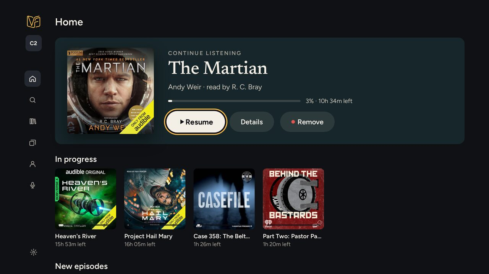
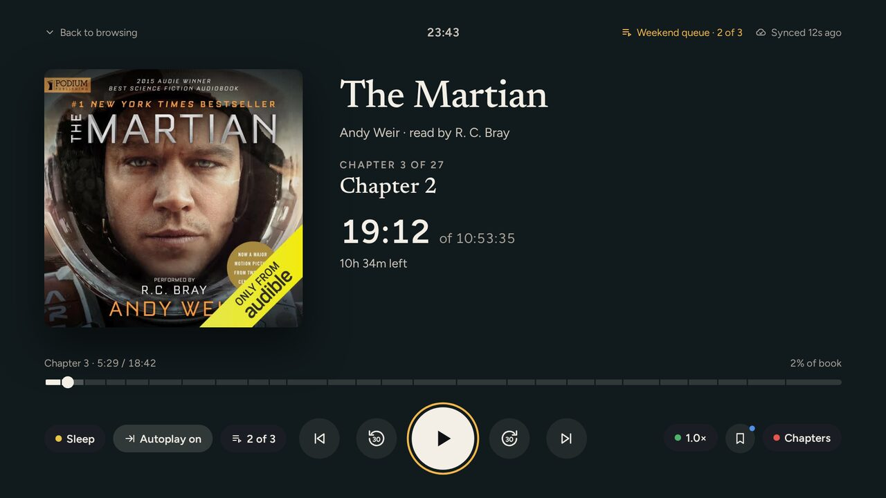
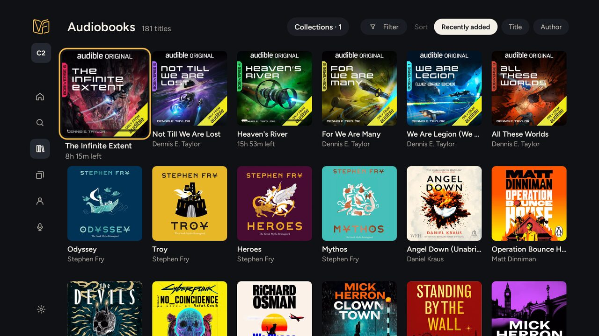
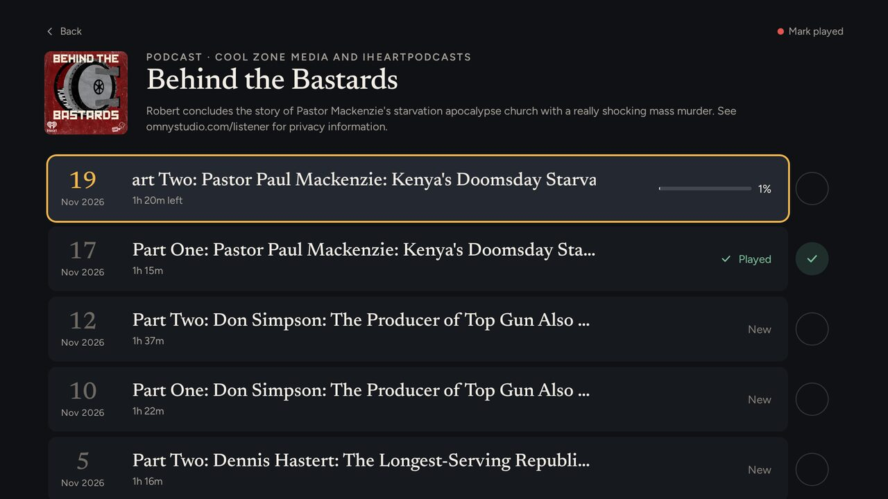
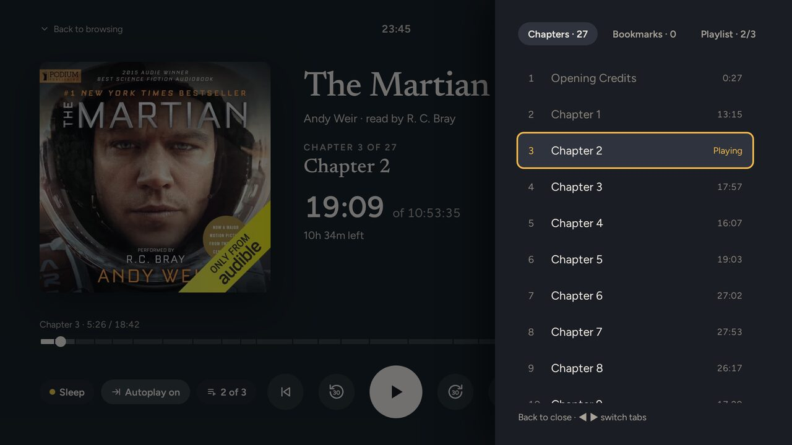

<p align="center">
  
</p>

<h1 align="center">Vox Folio</h1>

<p align="center">
  Your Audiobookshelf library on the big screen.<br>
  An audiobook and podcast player for LG webOS TVs, made for the remote and the sofa.
</p>

<p align="center">
  <a href="https://github.com/Odd-Orbit-Software/Vox-Folio/actions/workflows/build.yml"></a>
  <a href="https://github.com/Odd-Orbit-Software/Vox-Folio/releases/latest"></a>
  <a href="https://odd-orbit-software.github.io/Vox-Folio/"></a>
</p>

<p align="center">
  <a href="https://odd-orbit-software.github.io/Vox-Folio/"><b>Documentation</b></a> ·
  <a href="https://github.com/Odd-Orbit-Software/Vox-Folio/releases"><b>Releases</b></a> ·
  <a href="https://github.com/Odd-Orbit-Software/Vox-Folio/actions/workflows/build.yml"><b>Latest CI build</b></a>
</p>



## Pick up where you left off

Vox Folio signs in to your own Audiobookshelf server and keeps your place in step with every other app you use. Pause on your phone, press play on the TV, and the book carries on from the same sentence.

| | |
| --- | --- |
|  |  |
|  |  |

## What it does

- **Listen properly.** Chapters, bookmarks, a sleep timer that fades out gently, and speeds from 0.5× to 2× with the pitch kept natural.
- **Live sync.** Positions move between devices as they happen, with an undo if you didn't mean it.
- **Browse the way you think.** Home rows you choose and order, a library with filters, series, authors, collections and search.
- **Series and playlists keep going.** The next book or episode starts on its own, with an Up Next card first.
- **Podcasts.** Shows, new episodes, mark played, and their own playback speed.
- **Made for a TV.** Every control works with the D-pad, the coloured buttons have a guide, and the screensaver can turn the screen fully black for OLED panels.
- **Shared TVs.** Profiles for everyone in the house, each with their own place, settings and Year in Review.

## Get it

Download the latest `.ipk` from [Releases](https://github.com/Odd-Orbit-Software/Vox-Folio/releases), or every build from [CI](https://github.com/Odd-Orbit-Software/Vox-Folio/actions/workflows/build.yml), and install it on a TV in Developer Mode or with the Homebrew Channel. The [installation guide](https://odd-orbit-software.github.io/Vox-Folio/user/) has the steps.

You'll need your own [Audiobookshelf](https://www.audiobookshelf.org) server. Vox Folio is tested with 2.37, and tells you if a server is too old.

## Build it

```sh
npm install
npm test
npm run build      # production build into dist/, then the Chromium 79 syntax check
npm run package    # build/…ipk
```

How it fits together, the webOS quirks and how they were solved are in the [developer guide](https://odd-orbit-software.github.io/Vox-Folio/dev/).

---

<p align="center">
  <a href="https://oddorbit.software"></a><br>
  Made by <a href="https://oddorbit.software">Odd Orbit Software</a>
</p>
