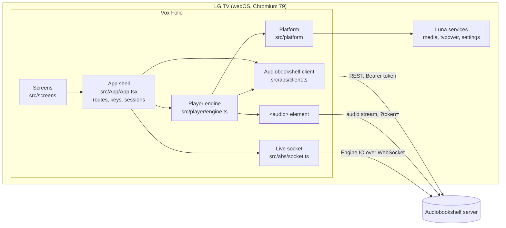

# Architecture

Vox Folio is a packaged webOS web app. It runs from `file://` inside the TV's web app container (Chromium 79), talks to Audiobookshelf over HTTPS and a WebSocket, and calls a few TV system services through the Luna bridge. It is written in TypeScript with React 19 and Enact's core, spotlight and ui packages, without an Enact theme.

## How it fits together

- **App shell** (`src/App/App.tsx`) owns the signed-in session (one client and one engine per profile), the route stack, global keys, Up Next and the playlist queue. It reacts to engine events: the end of a book, notices, sign-in expiry.
- **Screens** (`src/screens`) are plain React components. Each one fetches what it shows through the client and keeps a small cache so Back returns instantly.
- **Player engine** (`src/player/engine.ts`) drives one `<audio>` element. It opens listening sessions, maps book time onto multi-file audio tracks, saves progress, runs the sleep timer and applies smart rewind. It publishes a single `PlayerState` that screens subscribe to.
- **Audiobookshelf client** (`src/abs/client.ts`) wraps the REST API, handles token refresh, and builds authorised cover and audio URLs.
- **Live socket** (`src/abs/socket.ts`) receives progress changes from other devices.
- **Platform** (`src/platform`) wraps the webOS specifics: Luna calls, launch parameters, the remote's key codes, the TV screensaver and playback speed.

## Project layout

| Path | Contents |
| --- | --- |
| `src/abs` | API client, live socket, types, persistent storage |
| `src/app` | Pure logic with unit tests: routes, settings, launch decisions, Up Next, playlist queue, filters, podcasts, stats, Year in Review |
| `src/player` | The engine and timeline maths (tracks, chapters, speed, smart rewind) |
| `src/platform` | webOS: Luna bridge, launch params and keys, screensaver, play rate, clock format |
| `src/components` | Shared UI: focusable controls, cover rows and grids, panels, the screensaver |
| `src/screens` | One file per screen |
| `src/styles` | Global tokens and screen CSS |
| `webos-meta` | `appinfo.json` and icons, copied into the package |
| `tools` | Deploy, launch, screenshot, probe listener and server test scripts |
| `docs/plans` | Working plans, kept in the repository and left off this site |

## Focus and the remote

Navigation uses Enact Spotlight. Every focusable control is a `Spottable` (`Button` or `Tile` in `src/components/controls.tsx`). Screens are `ScreenContainer`s that restore focus to the element named by the route's `focusKey` when you come back, so Back always lands where you were. Panels are `PanelScope`s that trap focus until closed.

Long lists (covers, chapters, settings) move with a CSS transform rather than scrolling. Focusing an off-screen item would otherwise make the browser scroll the clipping box as well, so `pinScroll` keeps that scroll at zero.
