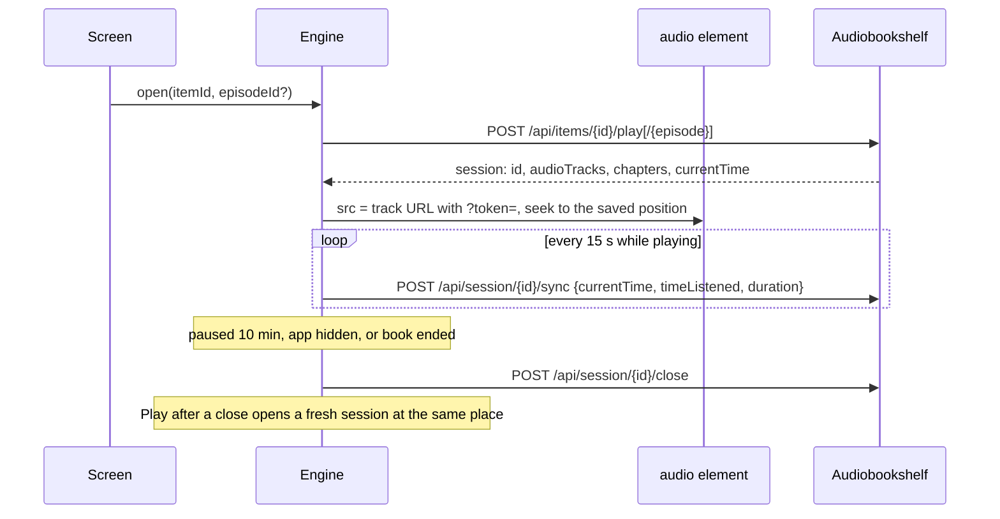
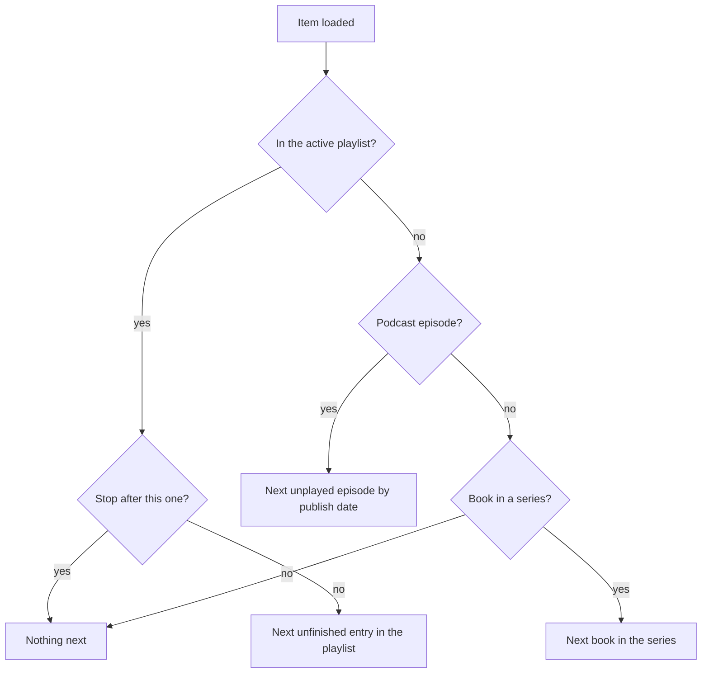

# Playback and sync

## Listening sessions

Audiobookshelf records listening as sessions. A session is opened when playback starts, updated with progress, and closed at the end. Only closed sessions count towards listening history and stats.

- **Multi-file books.** A session lists its audio tracks with start offsets. The engine keeps book time and works out which file and offset to load (`src/player/timeline.ts`).
- **Listening time** goes in `timeListened`, the seconds actually listened since the last sync. See [Fixes](fixes#listening-time-wasnt-recorded).
- **Offline.** A failed sync keeps the listened seconds and retries. After an outage the engine checks the server first, and only takes a newer position if it's further on, so another device's progress isn't overwritten.

## Catching up with other devices

There are three paths, from fastest to slowest:

1. **Live.** The socket delivers `user_item_progress_updated`. If the same book is paused here, `applyRemoteProgress` moves to it, applies smart rewind for the other device's pause, and offers an undo for 60 s. If it's playing here, the event is ignored and the first event from each other session raises a "playing in two places" notice.
2. **On resume.** `catchUp` runs when a paused book is played or the app returns to the foreground, and adopts any position saved since the last successful sync.
3. **On open.** A new session starts from the server's saved position.

## Speed

Any `playbackRate` other than 1 mutes audio in the webOS web app container, so the engine never sets it. `PlayRateController` asks the TV's media service to change the pipeline rate with audio kept on. See [webOS system calls](webos#playback-speed) and [Fixes](fixes#audio-muted-at-any-speed-other-than-1).

## Up Next, series and playlists

The shell works out what follows the loaded item and shows the Up Next card 15 seconds (real time, at the current speed) before the end.

When the item ends with Autoplay on, it's marked finished and the next one opens. The playlist queue (`src/app/queue.ts`) is saved to `localStorage` per user, so it survives a restart. Playing one of its entries keeps it, and anything else leaves it.

## Sleep timer

Timer mode counts listened time, so a pause doesn't use it up. End-of-chapter mode watches the chapter boundary. The volume fades over the chosen length (10, 30 or 60 s), and "Still listening?" appears 30 s before the end, or when the fade starts if that's earlier. Any key extends the timer.

## State

`PlayerState` is one immutable object published to subscribers. Screens read it with `usePlayer`. It carries the item, position, chapters, speed, sync state, sleep state, notices, and the remote-jump undo offer.
