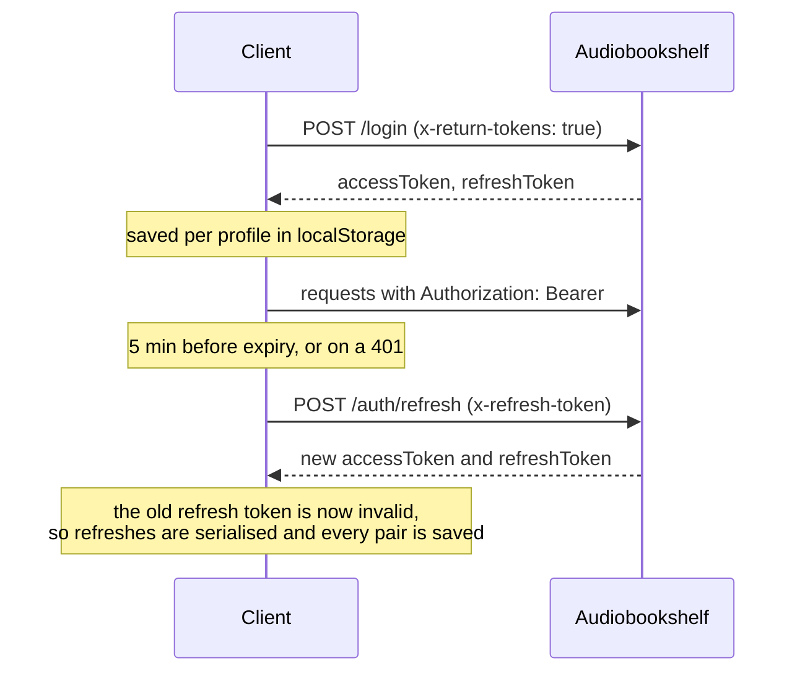
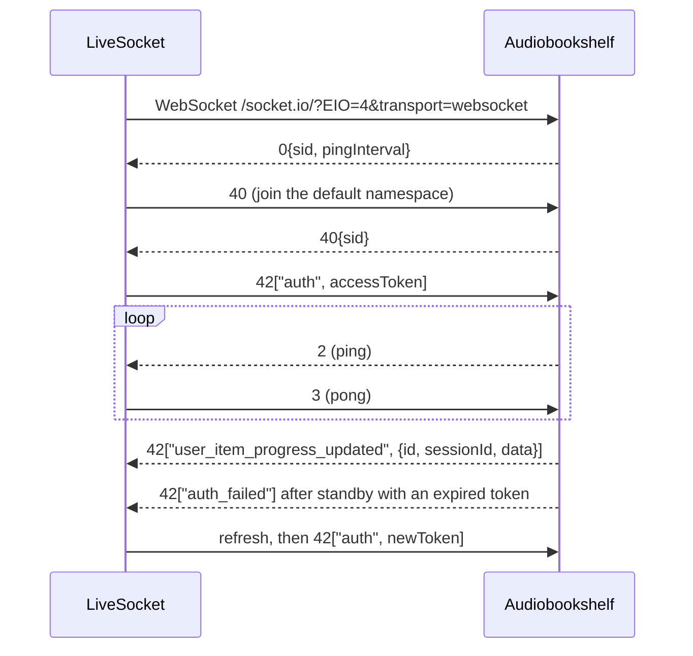

# Talking to Audiobookshelf

All requests go from the TV straight to the server. The app runs from `file://`, so the server's lack of CORS headers doesn't matter on the TV. A desktop browser needs web security turned off for the same reason.

## Signing in and tokens

Audiobookshelf 2.37 issues short-lived access tokens (1 h) and rotating refresh tokens.

Cover and audio URLs can't carry headers, so they take the token as `?token=`. `keepFresh` refreshes ahead of expiry so images keep loading, and `ensureFresh` runs when the TV wakes, because timers lag during standby.

## Endpoints used

| Purpose | Endpoint |
| --- | --- |
| Server check and version | `GET /ping`, `GET /status` |
| Libraries, items, pages | `GET /api/libraries`, `/api/libraries/{id}/items`, `/api/items/{id}?expanded=1` |
| Filters | `GET /api/libraries/{id}/filterdata`, `filter=<group>.<base64 value>` on items |
| Home shelves | `GET /api/libraries/{id}/personalized` |
| In progress and progress | `GET /api/me/items-in-progress`, `GET /api/me`, `GET /api/me/progress/{id}[/{episode}]` |
| Mark finished | `PATCH /api/me/progress/{id}[/{episode}]` |
| Remove from Continue listening | `GET /api/me/progress/{progressId}/remove-from-continue-listening` |
| Playback | `POST /api/items/{id}/play[/{episode}]`, `/api/session/{id}/sync`, `/api/session/{id}/close` |
| Series, authors, collections, playlists | `/api/series/{id}`, `/api/authors/{id}`, `/api/collections/{id}`, `/api/playlists/{id}` |
| Podcasts | `/api/libraries/{id}/recent-episodes`, search with `podcast` and `episodes` results |
| Bookmarks | `POST` and `DELETE /api/me/item/{id}/bookmark` |
| Stats | `GET /api/me/listening-stats`, `GET /api/me/stats/year/{year}` |

## Live updates

The server speaks socket.io. Vox Folio talks to it directly over a WebSocket without the socket.io library, since the wire format is small.

A lost connection retries after 2, 5, 15, 30 and then 60 seconds. A socket that has heard nothing for 70 s is treated as dead, which catches half-open connections after standby. The TV's own session ID is used to ignore its own progress events.
