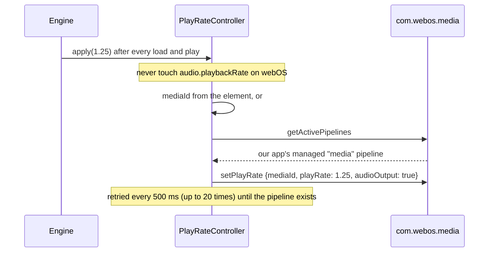
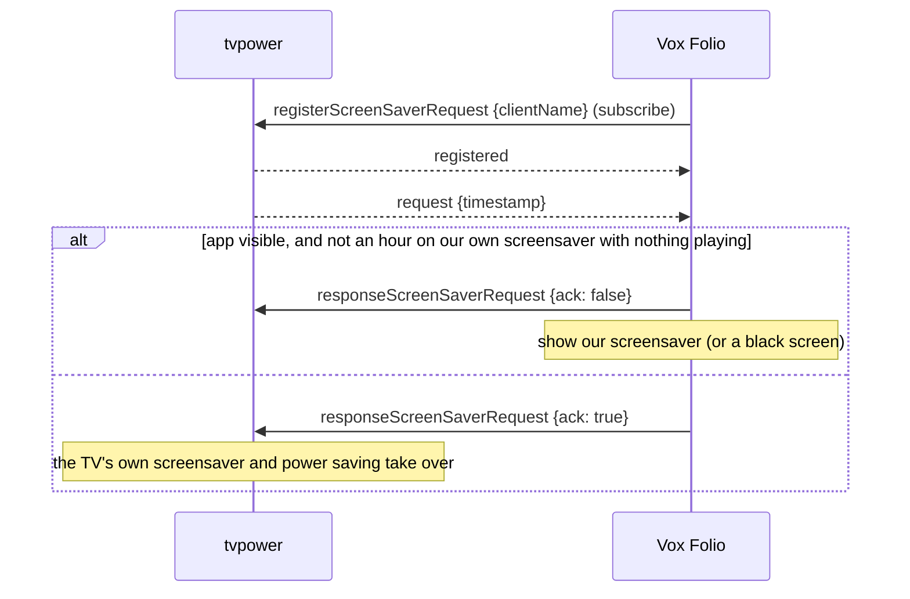

# webOS system calls

Web apps reach TV services through `PalmServiceBridge`, wrapped in `src/platform/luna.ts`. Each bridge is kept referenced until its reply arrives, because an unreferenced bridge can be garbage-collected mid-call. Every caller checks `canCallLuna()` first, so the same code runs in a desktop browser.

| Service call | Used for | Where |
| --- | --- | --- |
| `luna://com.webos.media/setPlayRate` | Playback speed with sound | `platform/playRate.ts` |
| `luna://com.webos.media/getActivePipelines` | Finding our audio pipeline when `mediaId` isn't exposed | `platform/playRate.ts` |
| `luna://com.webos.service.tvpower/power/registerScreenSaverRequest` | Being asked before the TV starts its screensaver (subscription) | `platform/screensaver.ts` |
| `luna://com.webos.service.tvpower/power/responseScreenSaverRequest` | Answering that request | `platform/screensaver.ts` |
| `luna://com.webos.settingsservice/getSystemSettings` | The TV's 12 or 24 hour clock setting | `platform/clockFormat.ts` |

## Playback speed



A new file starts a new pipeline at 1×, so the rate is applied again on every load and play. In a desktop browser the controller sets `playbackRate` instead.

## The TV screensaver



The key press that wakes the screensaver is swallowed in the capture phase, so it doesn't also pause or move focus.

## Launching and relaunching

| Source | Read with |
| --- | --- |
| Launch parameters | `webOSSystem.launchParams` (or `PalmSystem.launchParams` on older firmware), as JSON |
| Relaunch while running | the `webOSRelaunch` document event |
| Desktop browser | the query string |

Another app can open a book or episode directly:

```sh
luna-send -n 1 luna://com.webos.applicationManager/launch \
  '{"id":"software.oddorbit.voxfolio","params":{"abs":"<item id>","episode":"<episode id>"}}'
```

With several profiles, the book opens for whoever listened to it last. Polaris, a companion launcher, uses this to open Continue cards.

## App lifecycle

- **Hidden** (Home button, input change, standby): the engine syncs and closes its session, so the time is recorded.
- **Visible again**: the client refreshes its token if it's close to expiry, the socket reconnects, and a paused book catches up with other devices.
- **Exit**: the session is closed with `keepalive: true`, so the request completes as the app shuts down.

## Remote keys

| Key | Code |
| --- | --- |
| Back | 461 |
| Red, Green, Yellow, Blue | 403, 404, 405, 406 |
| Play, Pause, Stop | 415, 19, 413 |
| Rewind, Fast-forward | 412, 417 |
| Channel up, down | 33, 34 |
