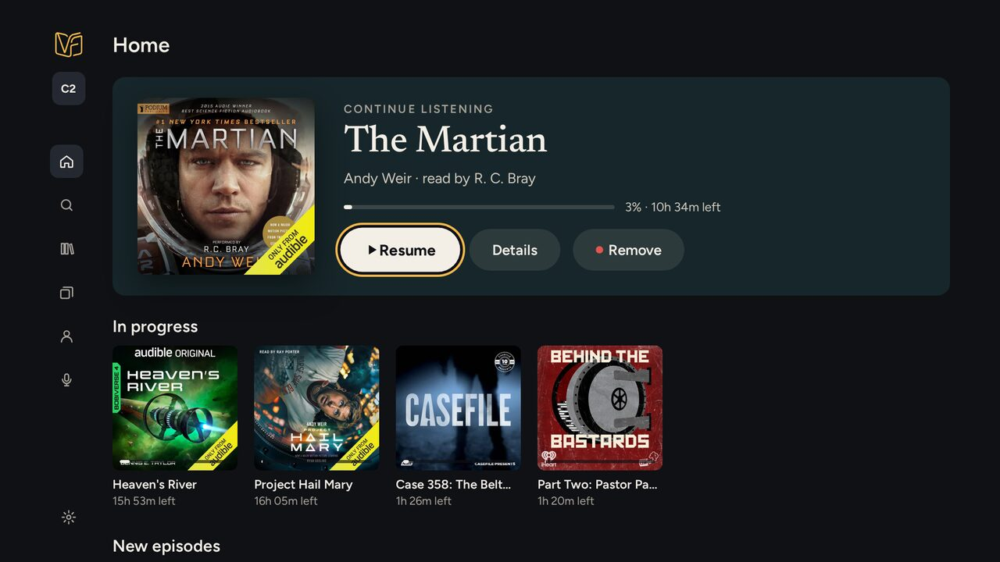

# Vox Folio

Vox Folio plays your [Audiobookshelf](https://www.audiobookshelf.org) library on an LG webOS TV. It signs in to your own server, keeps your place in step with your other devices, and works entirely from the remote.

## Where to start

- **[User guide](user/)**: installing, signing in, and everything the app does.
- **[Developer guide](dev/)**: how the app is built, the webOS calls it relies on, and the problems the TV threw up along the way.

## Downloads

- [Releases](https://github.com/pmck91/Vox-Folio/releases) carry an `.ipk` and a Homebrew Channel manifest.
- [The latest CI build](https://github.com/pmck91/Vox-Folio/actions/workflows/build.yml) has an `.ipk` attached to every run.

Vox Folio is made by [Odd Orbit Software](https://oddorbit.software).
