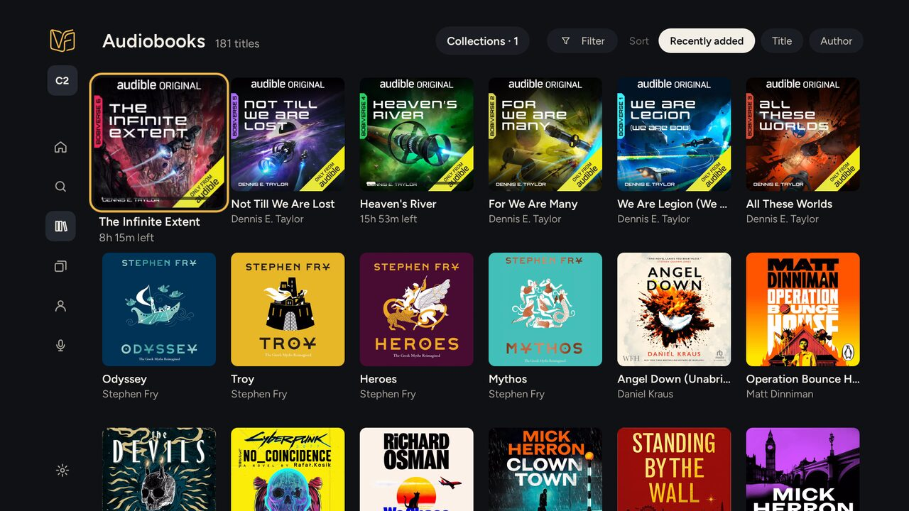

# Finding something to listen to

The side rail holds Home, Search, Library, Series, Authors, Podcasts ★ and Settings. Press Left from anywhere on a screen to reach it.

## Library

Every book in the library, as covers. Sort by **Recently added**, **Title** or **Author**. With more than one book library, the library name at the top switches between them.

**Filter** narrows the list to one thing at a time:

- **Progress:** not started, in progress or finished
- **Genre, Narrator, Tag, Language:** from your server's own data

Genres that a metadata source joined into one long string are split into separate genres, and different spellings of a language are merged. While a filter is on, the chip shows it and the count reads, for example, "7 of 181 titles". **Red** on the chip, or in the filter panel, shows all books again. In long lists such as narrators, Channel up and down jump eight at a time.

**Collections** appears beside the sort options when your server has collections or playlists.

## A book's page

Opening a book shows its details, series and authors. From here you can play, start over, or mark it finished or unfinished. For a book in a series, the page shows the next book and a switch for Autoplay.

## Series and authors

**Series** lists every series with its books in order and your progress through them. **Authors** lists everyone with books in the library. An author's page groups their books by series.

## Search

Search finds books by title, author, narrator or series, and podcast shows and episodes. Type with the TV keyboard or use the remote's voice button. When both books and podcasts match, chips at the top switch between **All**, **Audiobooks** and **Podcasts**.
