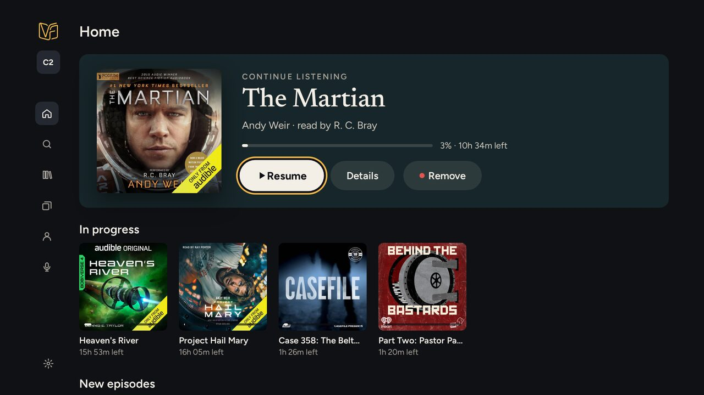

# Home

The large card at the top is the book or episode you played most recently. **Resume** carries on from where you stopped, on any device. When it's already loaded, the button reads **Back to player**.

Below it are rows you can choose and order yourself:

| Row | Shows |
| --- | --- |
| In progress | Everything else you're partway through, books and podcast episodes together |
| New episodes ★ | The latest episodes from your podcasts |
| Continue series | The next book in each series you've started |
| Recently added | New to the library |
| Discover | Books you haven't started, picked at random |
| Listen again | Books you finished a while ago (hidden at first) |
| New series | Series added to the library lately (hidden at first) |

**Choose Home rows** at the bottom of Home opens the settings for this. Each row can be shown or hidden, and Channel up and down move the focused row. See [Settings](settings).

## Taking something off Continue listening

To take an item off Home without finishing it, press **Red** on its tile in In progress, or choose **Remove** on the main card. For a few seconds after, Red puts it back. Listening to it again brings it back too.

## Up to date on its own

Home opens instantly from a saved copy, then refreshes. When you listen on another device, Home updates its progress bars and cards while you watch. It never swaps the main card while you're on it.

## Year in Review ★

From 1 December to 15 January, Home offers your year in listening. **See your year** opens it, and **Later** asks again in a week. See [Stats](stats).
