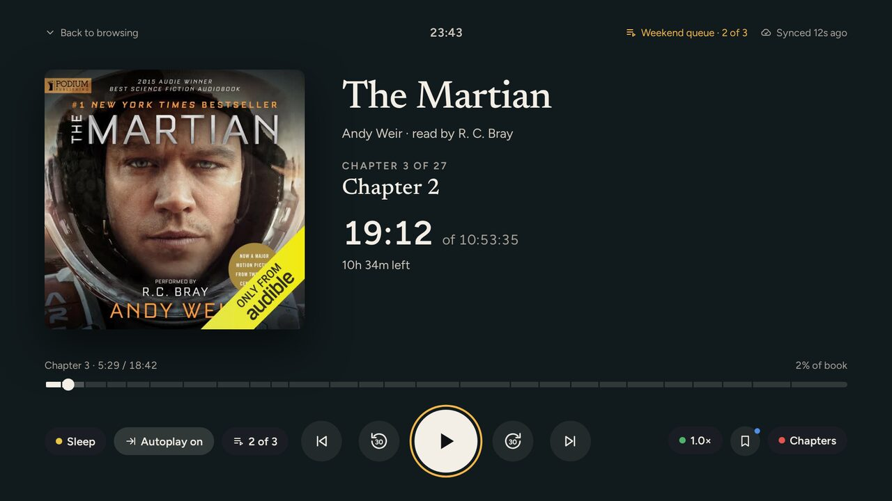
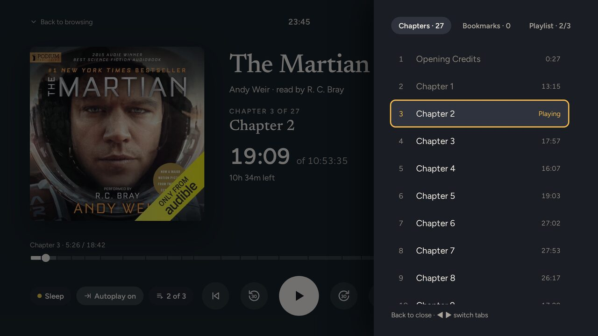

# The player

The player shows the cover, the chapter, the time and how long is left at your current speed. Back returns to browsing and the book keeps playing. **Blue** from any other screen brings you back here.

## Controls

| Control | What it does |
| --- | --- |
| Play / Pause | The large button in the middle, or the remote's own play and pause keys |
| Skip back and forward | The buttons beside Play, or the remote's rewind and fast-forward keys. The lengths are in Settings |
| Previous and next chapter | The outer buttons, or Channel down and up |
| Progress bar | Move focus to it, press Left or Right to look through the book, then OK to jump there. Back cancels. Holding the key speeds it up |

## The coloured buttons

- **Red: Chapters, bookmarks and the playlist.** One panel with tabs. Left and Right switch tabs, OK jumps, and Channel up and down move eight rows at a time.
- **Green: Speed.** From 0.5× to 2× in steps of 0.05, with presets. Books and podcasts keep separate speeds.
- **Yellow: Sleep timer.** 15, 30, 45 or 60 minutes, or the end of the chapter. The sound fades out at the end, and "Still listening?" appears first. Any key adds the same time again.
- **Blue: Bookmark.** Saves a bookmark at this moment. Bookmarks are stored on your server, so other apps see them too. Podcast episodes don't have bookmarks.

## Autoplay and Up Next

For a book in a series, a podcast episode or a playlist, the **Autoplay** chip beside Sleep turns it on or off. When it's on, an Up Next card appears 15 seconds before the end. The next item then starts, and the one you finished is marked finished. **Not now** cancels it this time.

## Keeping your place

- Your position saves to the server every 15 seconds while you listen, and whenever you pause, leave the app or switch books.
- **Smart rewind** replays a little when you come back after a pause: 5 seconds after a minute, 15 after ten minutes, 30 after an hour. It never goes back past the start of the chapter.
- When another device saves a newer position while the book is paused on the TV, the player moves there at once and says so. For a minute it offers **Back to** your old position.
- When the same book plays on the TV and another device at the same time, a note warns that the last one to stop keeps the place.
