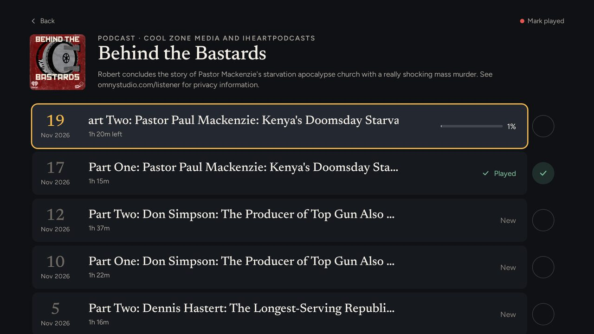

# Podcasts ★

The **Podcasts** tab appears when your server has a podcast library. It shows episodes you're partway through, the latest episodes, your shows and your podcast playlists.

A show's page lists its episodes, newest first, with the date, length and your progress. The description at the top follows the episode you're on.

- **OK** plays an episode.
- **Red**, or the round button at the end of the row, marks an episode played or unplayed.

Episodes resume and sync like books. Autoplay goes on to the next episode in the order they came out, skipping any you've played. Podcasts have their own speed, separate from books.

Vox Folio plays the episodes your server has downloaded. Subscribing and downloading happen in the Audiobookshelf web app.
