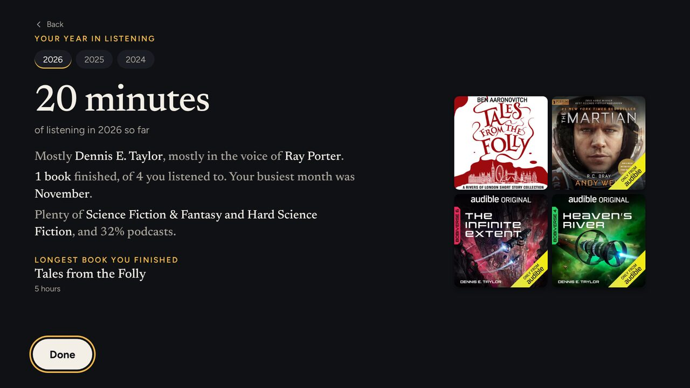

# Listening stats ★

**Settings → Listening stats** shows your time listened this week, this year and in total, your current and longest streak, the last seven days as bars, and how many books you've finished.

# Year in Review ★

**Settings → Year in review** (or the button on the stats page) sums up a year: total hours and a weekly average, your most-listened author and narrator, top genres, books finished, your busiest month, the longest book you finished, and the covers of the year. OK on a cover opens that book. Chips at the top switch between this year and the two before.

From 1 December to 15 January, Home offers the review too.

Listening time comes from Audiobookshelf's own records, which count a session once it ends. Vox Folio ends sessions when you pause for a while, leave the app, or finish a book.
